# Vision Action Platform

<p align="center">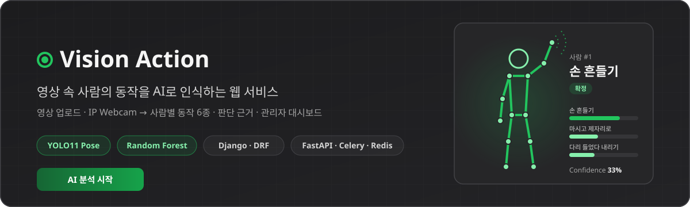</p>

## 1. 프로젝트 소개

Vision Action Platform은 영상 속 사람의 동작을 AI로 인식하는 웹 서비스입니다. 동작 인식 모델을 스크립트로 돌릴 필요 없이, 브라우저에서 분석을 요청하고 결과를 기록으로 남길 수 있습니다. 화면은 흰/어두운 회색 배경에 그린 포인트를 쓰고, 오른쪽 위 버튼으로 라이트·다크 모드를 바꿀 수 있습니다(Django Admin도 같은 테마).

<p align="center">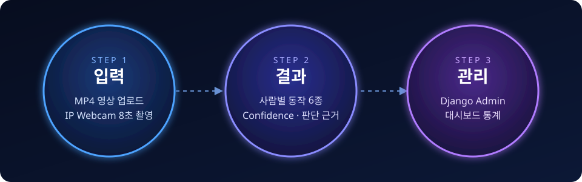</p>

<p align="center">
   <br>
   <br>
  
</p>

> 확률이 낮거나 1·2등 차이가 작으면 답을 확정하지 않고 **판단 보류**로 표시합니다. 결과는 참고용이며 위험 행동 판정이 아닙니다.

## 2. 실행 방법

<p align="center">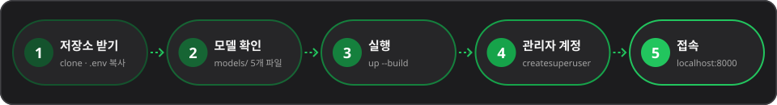</p>

**준비물** &nbsp;  

#### 1️⃣ 저장소 받기 · `.env` 만들기

```bash
git clone https://github.com/hxxdxm/vision_action_platform.git
cd vision_action_platform
cp .env.example .env
```

`.env`에서 비밀번호와 IP Webcam 주소만 바꾸면 됩니다. `.env`는 Git에 올라가지 않습니다.

#### 2️⃣ 모델 파일 확인

모델은 저장소에 함께 들어 있어서 따로 받을 필요가 없습니다(`ai_service/models/`, 약 6.6MB).

<details>
<summary>파일 목록 보기</summary>

```text
ai_service/models/
├── rf_action_baseline.joblib   # Random Forest (300 trees, 입력 1,140)
├── rf_feature_columns.json     # 1,140개 Feature 이름과 순서
├── rf_training_info.json       # 6 Class, 30 Step, min_valid_frames 10
├── yolo11n-pose.pt             # YOLO Pose 가중치
└── SHA256SUMS.txt
```

</details>

> [!NOTE]
> AI 서버는 시작할 때 `SHA256SUMS.txt`로 파일이 바뀌지 않았는지 확인한 뒤에만 모델을 불러옵니다.

#### 3️⃣ 실행

```bash
docker compose up --build -d
docker compose ps
```

5개 서비스가 모두 `running`/`healthy`면 준비 완료입니다. **마이그레이션은 django가 시작할 때 자동으로 적용**됩니다. 직접 하려면 `docker compose exec django python manage.py migrate`를 실행합니다.

#### 4️⃣ 관리자 계정 만들기

```bash
docker compose exec django python manage.py createsuperuser
```

> [!TIP]
> `.env`에 `DJANGO_SUPERUSER_*` 값을 채워 두면 처음 실행할 때 관리자 계정이 자동으로 만들어져서 이 단계를 건너뛸 수 있습니다.

#### 5️⃣ 접속

| | 화면 | 주소 |
|:---:|---|---|
| 🙋 | 사용자 화면 (회원가입 → AI 분석) | http://localhost:8000/ |
| 🛠️ | Django Admin | http://localhost:8000/admin/ |
| 📊 | 관리자 대시보드 | http://localhost:8000/dashboard/ |
| ⚡ | FastAPI 문서 (개발용) | http://localhost:8001/docs |

<details>
<summary>🧪 테스트 실행</summary>

```bash
docker compose exec django python manage.py test           # 웹·권한·Celery 저장·사용자별 번호·Admin 조회 전용 18개
docker compose exec fastapi python -m pytest -q tests      # AI 서버 7개 (테스트 영상이 있으면 실제 추론까지)
```

</details>

## 3. 전체 아키텍처

`compose.yaml`이 실행하는 서비스 5개(점선 박스)와 오가는 데이터입니다. 브라우저에 공개되는 것은 `django`(8000) 하나이고, 서비스끼리는 `localhost`가 아니라 서비스 이름(`fastapi`, `redis`, `postgres`)으로 통신합니다.

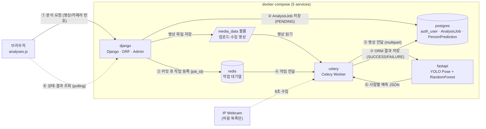

| 서비스 | 맡은 일 | 하지 않는 일 |
|---|---|---|
| django | 회원, 분석 요청 CRUD, 권한, 화면, Admin, 대시보드 집계 | AI 추론, 모델 학습 |
| celery | 영상 확보(업로드 파일 / IP Webcam 수집), FastAPI 호출, ORM 저장, 재시도 | 화면 렌더링 |
| redis | Celery 메시지 브로커 | 업무 데이터 영구 저장 |
| fastapi | 영상 → Pose·Tracking → Feature → Random Forest → JSON | DB 테이블·ORM·회원 관리 |
| postgres | 사용자·작업·사람별 예측 영구 저장 (`postgres_data` 볼륨) | — |

## 4. DB 설계 (ERD)

직접 작성한 모델: [`backend/analyses/models.py`](backend/analyses/models.py) (`auth_user`는 Django 기본 제공)

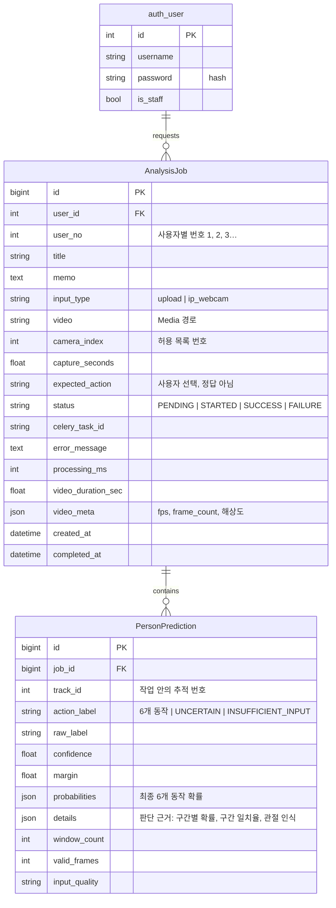

| 테이블 | 저장하는 것 |
|---|---|
| `auth_user` | 회원(아이디, 비밀번호 해시, 관리자 여부) |
| `AnalysisJob` | 분석 요청 1건: 누가, 어떤 입력으로, 지금 상태, 오류 사유, 처리 시간. 화면에는 사용자별 번호(`user_no`)로 표시 |
| `PersonPrediction` | 한 작업 안의 사람 1명의 예측. 두 사람이 나오면 작업 1건에 2행. `(job, track_id)` 유일. 화면 그래프에 쓰는 판단 근거(`details`)도 함께 저장 |

- 영상 파일 자체는 DB가 아니라 Media 볼륨에 두고 경로만 저장합니다.
- `id`는 전체 사용자 공통 번호(주소·API·Admin에서 사용), `user_no`는 그 사용자의 몇 번째 작업인지(화면 표시용)입니다. 새 작업을 만들 때 그 사용자의 마지막 번호 + 1로 정하고, 이미 있던 작업은 마이그레이션 `0003`이 만든 순서대로 채웠습니다.
- IP Webcam 주소는 DB·화면에 남기지 않고 허용 목록 번호(`camera_index`)만 저장합니다.
- 작업을 삭제하면 사람별 예측은 `CASCADE`로 함께 지워집니다. 서비스 화면(삭제·전체 지우기)에서 지우면 업로드 영상 파일도 함께 지웁니다. 처리 중(STARTED)인 작업은 삭제할 수 없습니다.

## 5. AI 추론 버튼 구현 흐름

사용자가 **AI 분석 시작** 버튼을 한 번 누르면 일어나는 일과 각 단계를 맡은 파일입니다.

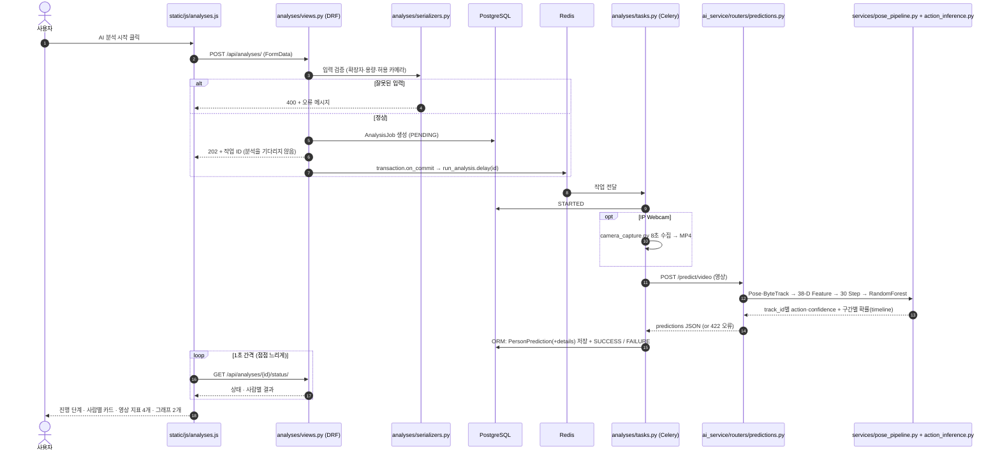

상단 지표와 그래프는 **누적 통계가 아니라 지금 보는 영상 한 건**의 값입니다. 이력 표에서 다른 행을 누르면 그 영상의 결과로 바뀌고, 한 영상에 사람이 여럿이면 사람 카드를 눌러 바꿉니다. 전체 누적 통계는 관리자 대시보드에서만 봅니다.

## 6. 사용한 모델과 입력 형식

| 항목 | 내용 |
|---|---|
| 동작 분류 모델 | `rf_action_baseline.joblib` (6일차 Random Forest, 300 trees, S01 6 clip 학습) |
| 입력 Feature | 30 Step × 38 Feature = 1,140 (정규화 좌표 34 + 팔꿈치·무릎 각도 4) |
| Pose | `yolo11n-pose.pt` (COCO 17 Keypoint), image_size 640, person_conf 0.25, ByteTrack |
| 지원 동작 | `bend_return`, `leg_raise_lower`, `walk_turn_walk`, `drink_return`, `sit_stand`, `wave` |
| 업로드 형식 | MP4 등 영상, 최대 50MB. 전신이 보이는 3~10초 영상 권장 |
| IP Webcam | `.env`의 `IP_WEBCAM_ALLOWED_URLS`에 등록한 카메라만, **8초** 수집 |

**FastAPI API 계약**

| 엔드포인트 | 입력 | 반환 |
|---|---|---|
| `GET /health` | 없음 | 서버 상태, 모델 준비 여부, Class 6개, Feature 1,140 |
| `POST /predict/video` | multipart `file` (영상) | `status`(ok/no_person), 영상 정보, `predictions[]`, `processing_ms` |

```json
{
  "status": "ok",
  "video": {"filename": "S03_A001_T01.mp4", "fps": 25.0, "frame_count": 62, "duration_sec": 2.48},
  "predictions": [
    {"track_id": 1, "action_label": "bend_return", "raw_label": "bend_return",
     "confidence": 0.25, "margin": 0.057, "window_count": 1, "window_agreement": 1.0,
     "valid_frames": 62, "detected_frames": 62, "interpolated_joints": 0, "mean_keypoint_conf": 0.95,
     "input_quality": "good", "probabilities": {"bend_return": 0.25, "leg_raise_lower": 0.193, "...": 0},
     "whole_probabilities": {"...": 0}, "window_mean_probabilities": {"...": 0},
     "timeline": [{"start_sec": 0.0, "end_sec": 2.44, "label": "bend_return", "probabilities": {"...": 0}}]}
  ],
  "processing_ms": 3100
}
```

- 읽을 수 없는 영상 → `422` + 사유 / 지원하지 않는 형식·빈 파일 → `400` / 모델 미준비 → `503`
- 영상은 정상인데 사람이 없음 → `200`, `status: "no_person"`, 빈 `predictions`
- `timeline`은 2초 구간(0.5초씩 이동)마다의 확률, `window_agreement`는 그 구간들 중 최종 1등과 같은 답을 낸 비율입니다. 화면의 "구간 일치율"과 그래프가 이 값을 씁니다.
- Celery는 422·400은 바로 **FAILURE**, 503·타임아웃·연결 실패는 **2번 재시도** 후 FAILURE로 저장합니다.

## 7. 실행 결과와 검증

<p align="center">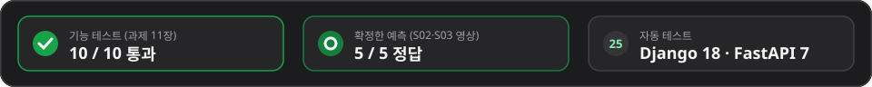</p>

캡처는 시연 PC(Windows + WSL2 Docker)에서 5개 서비스를 띄우고 라이트 모드로 찍었습니다. 이미지를 누르면 원본 크기로 열립니다.

### 7-1. 기능 테스트 (과제 11장)

| | 테스트 | 확인 방법 | 확인한 결과 |
|:---:|---|---|---|
| ✅ | **T01** 모델 불러오기 | `GET /health` · `test_health_model_ready` | 6개 Class, 1,140개 Feature 조건 일치 |
| ✅ | **T02** 영상 업로드 | `S03_A002_T01.mp4` 업로드 | 작업 등록 → 사람별 결과 표시 ([①](#7-2-주요-화면)) |
| ✅ | **T03** IP Webcam | 휴대폰 IP Webcam 8초 수집 | 앉았다 일어나기 확정 27.2%, 실제 동작과 일치 ([⑥](#7-2-주요-화면)) |
| ✅ | **T04** 사람별 결과 | 여러 사람이 나오는 영상 → Admin | 작업 #6에 Track 1·2·5 세 사람 결과 분리 |
| ✅ | **T05** 비동기 처리 | `test_create_returns_job_id_immediately` · 요청 직후 화면 | 202와 작업 ID 즉시 반환, 상태 "처리 중" |
| ✅ | **T06** 영구 저장 | `test_task_saves_predictions` · 새로고침 | 작업·예측 결과가 DB에 남음 |
| ✅ | **T07** CRUD 권한 | `test_user_cannot_touch_others_job` · 남의 작업 주소 | 다른 회원 작업은 404 |
| ✅ | **T08** 관리자 | `test_dashboard_admin_only` · `/dashboard/` | 관리자만 전체 목록·차트, 일반 회원 차단 |
| ✅ | **T09** 예외 처리 | `test_task_failure_is_saved` · `test_camera_failure_is_saved` | FAILURE와 사용자용 사유 저장 ([②](#7-2-주요-화면)) |
| ✅ | **T10** Docker | `docker compose restart` 후 `ps` · 이력 재조회 | 5개 서비스 Up, 데이터 유지 |

<details>
<summary><b>📸 테스트별 캡처 펼쳐 보기</b></summary>
<br>

<table>
<tr>
<td width="50%" align="center"><a href="docs/images/t01_health.png">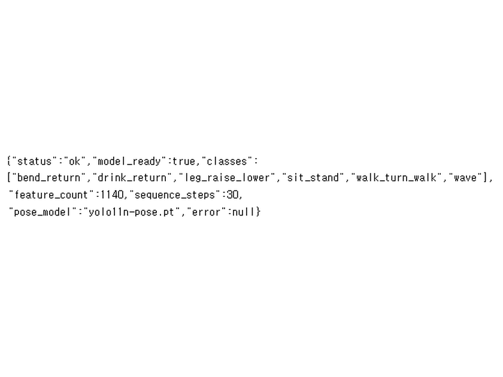</a><br><b>T01 모델 불러오기</b></td>
<td width="50%" align="center"><a href="docs/images/analysis.png">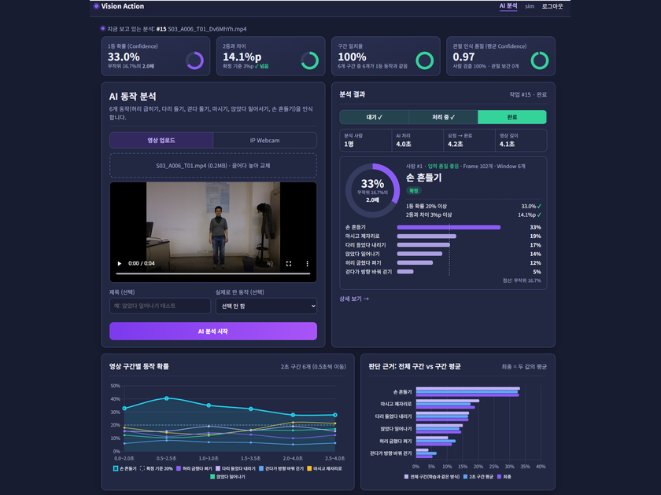</a><br><b>T02 영상 업로드</b></td>
</tr>
<tr>
<td width="50%" align="center"><a href="docs/images/t03_webcam.png">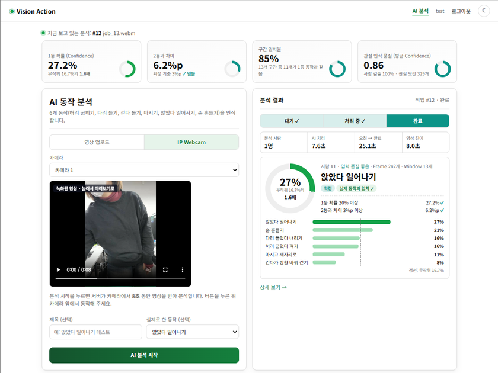</a><br><b>T03 IP Webcam</b></td>
<td width="50%" align="center"><a href="docs/images/admin_predictions.png">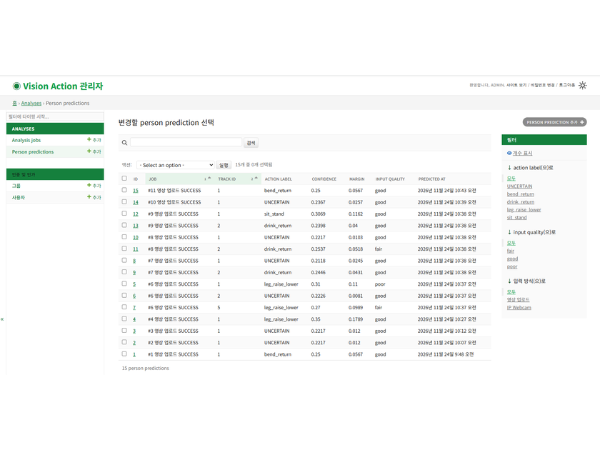</a><br><b>T04 사람별 결과</b></td>
</tr>
<tr>
<td width="50%" align="center"><a href="docs/images/t05_async.png">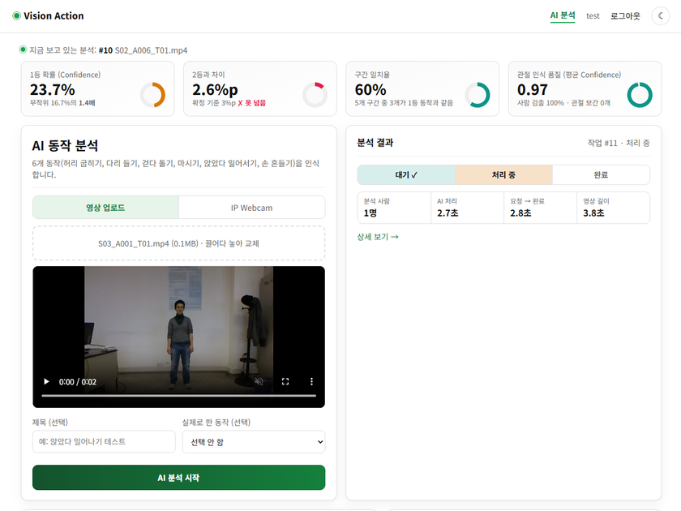</a><br><b>T05 비동기 처리</b></td>
<td width="50%" align="center"><a href="docs/images/history.png">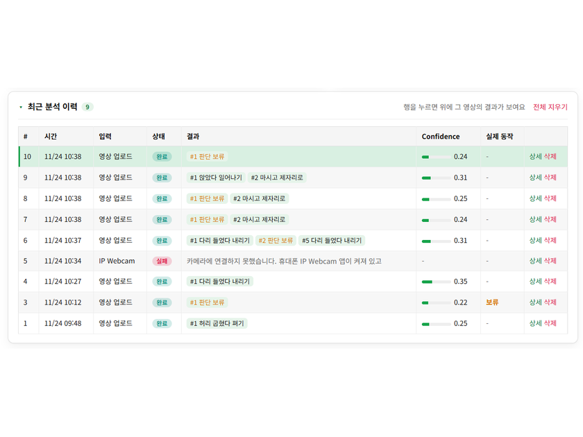</a><br><b>T06 영구 저장</b></td>
</tr>
<tr>
<td width="50%" align="center"><a href="docs/images/t07_forbidden.png">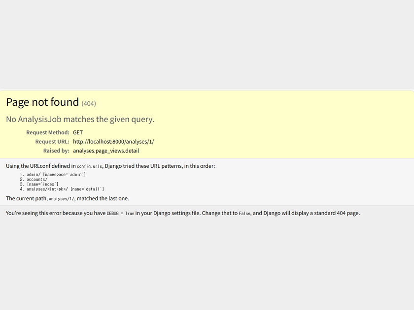</a><br><b>T07 CRUD 권한</b></td>
<td width="50%" align="center"><a href="docs/images/dashboard.png">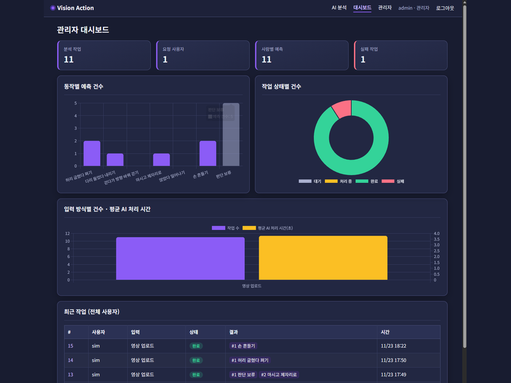</a><br><b>T08 관리자</b></td>
</tr>
<tr>
<td width="50%" align="center"><a href="docs/images/failure.png">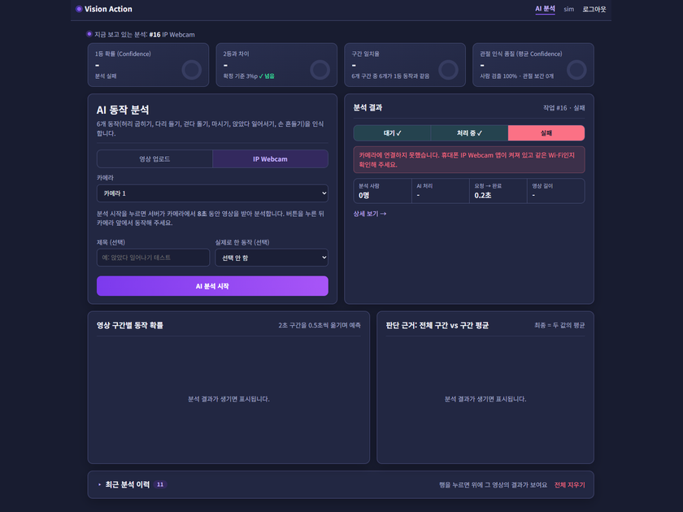</a><br><b>T09 예외 처리</b></td>
<td width="50%" align="center"><a href="docs/images/t10_restart.png">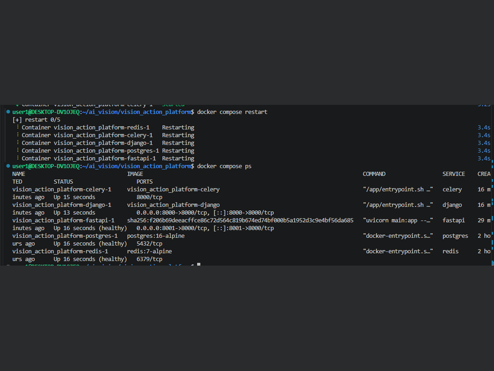</a><br><b>T10 Docker</b></td>
</tr>
</table>

</details>

### 7-2. 주요 화면

<table>
<tr>
<td width="50%" valign="top"><b>① 정상 분석</b><br><br><a href="docs/images/analysis.png">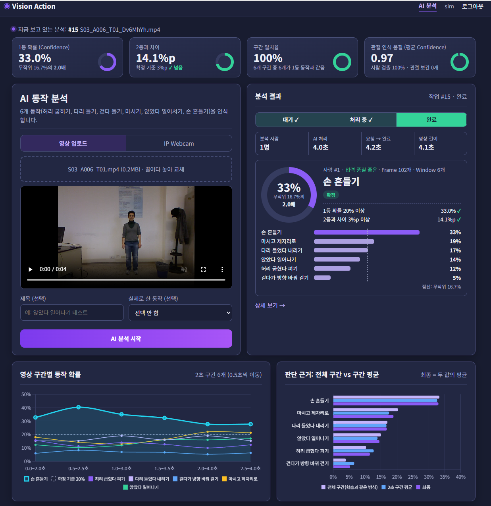</a><br><b>입력</b> 영상 업로드 · <code>S03_A002_T01.mp4</code><br><b>결과</b> 다리 들었다 내리기 <b>확정</b> 35.0% (무작위의 2.1배)<br>2등과 차이 17.9%p · 구간 3개 모두 일치 · AI 처리 2.2초</td>
<td width="50%" valign="top"><b>② 오류·실패</b><br><br><a href="docs/images/failure.png">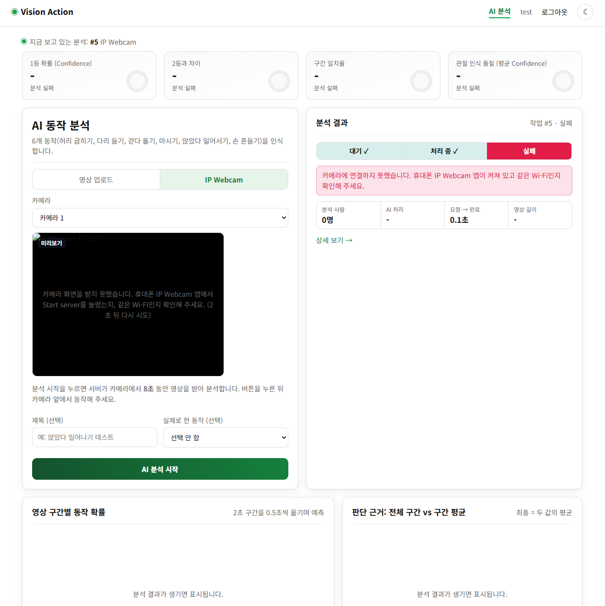</a><br><b>입력</b> IP Webcam · 휴대폰 앱이 꺼진 카메라<br><b>결과</b> <b>실패</b> · "카메라에 연결하지 못했습니다…"<br>실패한 작업도 사유와 함께 이력에 남음</td>
</tr>
<tr>
<td width="50%" valign="top"><b>③ 관리자 화면 (Django Admin)</b><br><br><a href="docs/images/admin_jobs.png">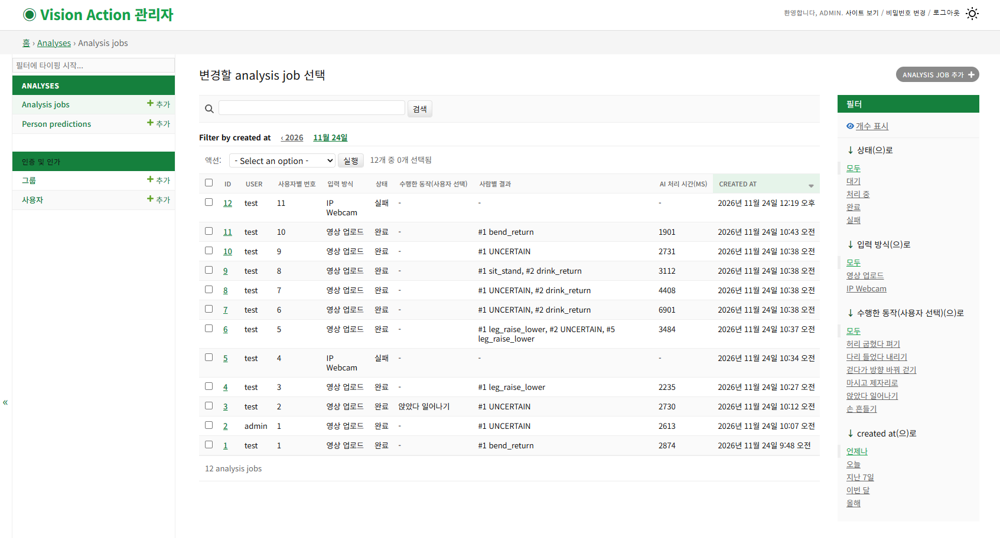</a><br><b>입력</b> 관리자 계정 · <code>/admin/</code> → Analysis jobs<br><b>결과</b> 전체 사용자 작업: 사용자별 번호·상태·사람별 결과·처리 시간<br>상태·입력 방식·동작·날짜 필터 · 일반 회원은 <a href="docs/images/admin_denied.png">접근 불가</a></td>
<td width="50%" valign="top"><b>④ 관리자 대시보드</b><br><br><a href="docs/images/dashboard.png">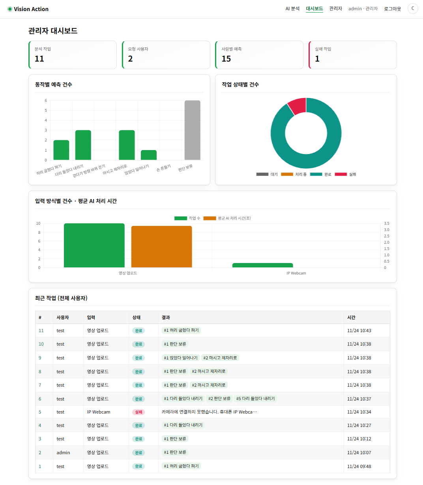</a><br><b>입력</b> 관리자 계정 · <code>/dashboard/</code><br><b>결과</b> 동작별 예측 건수(막대) · 작업 상태별 건수(도넛)<br>입력 방식별 건수 · 평균 AI 처리 시간</td>
</tr>
<tr>
<td width="50%" valign="top"><b>⑤ 판단 보류</b><br><br><a href="docs/images/uncertain.png">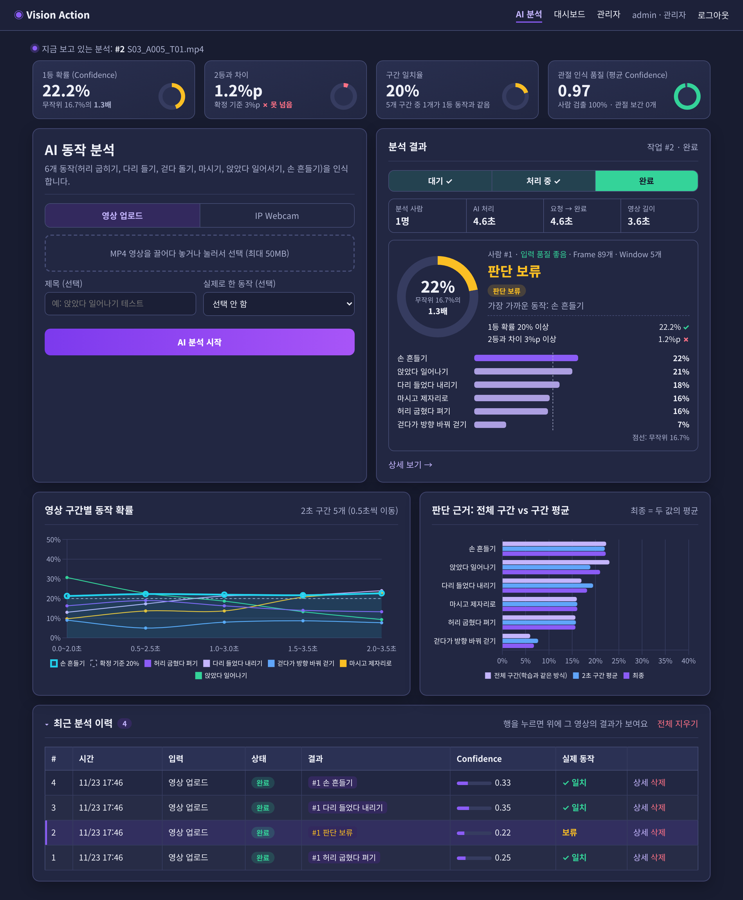</a><br><b>입력</b> 영상 업로드 · <code>S03_A005_T01.mp4</code> (앉았다 일어나기)<br><b>결과</b> 1등 22.2%와 2등 21%의 차이 1.2%p &lt; 기준 3%p<br>틀린 답을 확정하는 대신 <b>판단 보류</b></td>
<td width="50%" valign="top"><b>⑥ IP Webcam 분석</b><br><br><a href="docs/images/t03_webcam.png">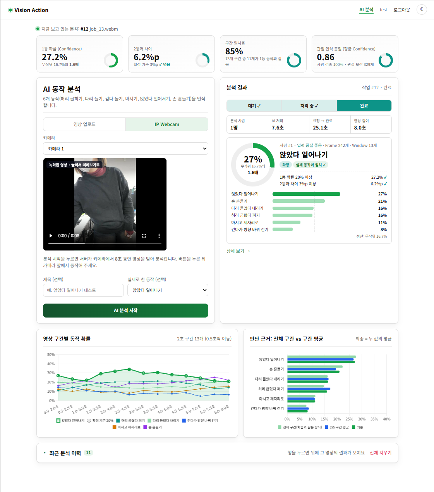</a><br><b>입력</b> 휴대폰 IP Webcam · 8초 수집 (Frame 242개)<br><b>결과</b> 앉았다 일어나기 <b>확정</b> 27.2% · 실제 동작과 일치<br>2초 구간 13개 중 11개 일치 · AI 처리 7.6초</td>
</tr>
</table>

### 7-3. 모델 재사용 검증 (5일차 영상 12개)

`ai_service/scripts/evaluate_videos.py`로 S02(검증용 사람)·S03(테스트용 사람) 영상을 서비스와 같은 코드로 분석했습니다. 결과 원본: [`docs/evaluation_S02_S03.txt`](docs/evaluation_S02_S03.txt)

| 방식 | S02 Top-1 | S03 Top-1 | 판단 확정한 결과의 정답률 |
|---|---|---|---|
| 6일차 그대로 (전체 구간 1회, 기준 0.55) | 2/6 | 6/6 | 0건 확정 (전부 UNKNOWN) |
| **이 서비스** (전체 구간 + 2초 Window 평균, margin 기준) | **4/6** | 5/6 | **5건 확정, 5건 정답** |

- 방식과 기준값은 **S02로만** 골랐고 S03은 마지막 확인에만 썼습니다(테스트 데이터로 튜닝하지 않음).
- 오답은 모두 1·2등 차이가 작아 "판단 보류"로 표시됐습니다. 확정한 결과는 모두 맞았습니다.
- 좌우 반전 예측 평균, 구간 길이 섞기, fps 영향도 같은 방법(S02로만 비교)으로 시험했지만 분명히 좋아지지 않아 반영하지 않았습니다: [`docs/inference_experiments.md`](docs/inference_experiments.md)

### 7-4. 처리 속도 (최적화 전후)

| 같은 영상 `S03_A001_T01.mp4` (2.5초, 62 Frame) | AI 처리 | 예측 결과 |
|---|---:|---|
| 최적화 전 (영상마다 YOLO 새로 불러옴) | 1.9초 | 허리 굽혔다 펴기 25.0%, 차이 5.7%p |
| 최적화 후 (서버 시작 시 1번 불러와 재사용) | **1.6초** | **동일** |

모델을 불러오는 시간(약 0.3초)이 매 요청에서 빠진 것이라, 영상이 짧을수록 비율로 크게 줄어듭니다. 각 1회 측정이라 ±0.1~0.2초 오차가 있을 수 있습니다.

## 8. 교재와 다르게 구현한 점과 이유

| 항목 | 교재·6~8일차 | 이 서비스 | 이유 |
|---|---|---|---|
| 판단 보류 기준 | 확률 0.55 미만이면 UNKNOWN | 확률 0.20 미만 **또는 1·2등 차이 0.03 미만**이면 판단 보류 | 6 clip으로 학습한 RF는 확률이 0.2~0.3대라 0.55면 7일차처럼 전부 UNKNOWN. S02로 기준을 다시 맞춤 |
| 예측 안정화 | 최근 5개 예측 다수결 | 전체 구간 확률 + 2초 Window 확률 평균을 반씩 | 다수결은 확률 정보를 버림. S02 Top-1 2/6 → 4/6 |
| 결측 관절 | 그대로 사용 | Confidence 0.3 미만 관절을 같은 사람의 앞뒤 Frame으로 보간 | 순간적으로 튀는 관절 값 완화 (Puchała 외, 2023) |
| 모델 파일 로드 | `joblib.load()` 바로 호출 | SHA256 해시 확인 후 로드 | `joblib.load`는 pickle 실행 → 우리 파일인지 확인 |
| 입력 품질 | 없음 | 검출 Frame 비율·관절 Confidence로 좋음/보통/나쁨 표시 | 과제 문서: "Confidence와 입력 품질을 함께 표시" |
| 카메라 주소 | 사용자 입력 | `.env` 허용 목록에서 번호로만 선택 | 임의 URL 호출(SSRF) 방지, 접속정보 비노출 |
| YOLO 모델 준비 | 영상마다 YOLO를 새로 불러옴 | 서버 시작 시 1번 불러와 빈 화면으로 미리 한 번 추론(warmup), 영상마다 첫 Frame에서 Tracker만 새로 만듦 | 가중치 로드·모델 준비 시간을 매 요청에서 없앰. Track ID는 영상마다 1부터 (inference_lock으로 한 번에 한 영상) |
| 웹 서버 | — | gunicorn 작업자 2개 × 스레드 4개 | IP Webcam 미리보기가 카메라 응답을 기다리는 동안에도 상태 조회·화면 요청이 막히지 않게 |
| Admin 권한 | 기본(모두 추가·수정 가능) | 사람별 예측은 조회만, 작업은 제목·메모만 수정, Admin에서 작업 추가 불가 | AI 결과는 Celery Worker만 저장. Admin에서 만든 작업은 Celery에 등록되지 않아 대기 상태로 멈춤 |
| 작업 번호 | DB id 그대로 | 화면에는 사용자별 번호(`user_no`), 주소·API·Admin에는 전체 공통 id | id만 쓰면 다른 회원 작업 때문에 내 이력이 1, 3, 4…로 띄엄띄엄 보임 |
| 화면 테마 | 없음 | 흰/어두운 회색 배경 + 그린 포인트, 라이트/다크 전환(브라우저에 기억), Django Admin도 같은 테마 | 발표·캡처 환경에 맞게 고를 수 있고, 서비스와 관리자 화면이 한 제품처럼 보이게 |
| 결과 화면 | 동작 이름과 확률 | 영상 한 건의 판단 근거(구간별 확률 그래프, 구간 일치율, 관절 인식 품질)를 함께 표시 | 확률이 낮은 모델이라 숫자 하나보다 "왜 이 답인지, 왜 보류했는지"를 보여 주는 게 더 정직함 |

참고 논문
- Nunes, Faria, Peixoto (2017). *Pattern Recognition Letters* — 스켈레톤 Feature + Random Forest
- Puchała, Kasprzak, Piwowarski (2023). *Sensors* 23(14) — 포즈 Tracking + 슬라이딩 Window, 결측 관절 보정
- Yan, Xiong, Lin (2018). *AAAI* — ST-GCN (데이터가 늘면 FastAPI 서버만 교체하는 확장 방향)

## 9. 문제 해결 기록

**1) 7일차처럼 모든 결과가 UNKNOWN**
- 보인 문제: 정답 동작이 1등인데도 확률 0.25라 기준 0.55에 걸려 전부 UNKNOWN
- 확인한 곳: `reports/day07/runtime_comparison.md`(평균 Confidence 0.23), S02 영상 6개의 확률 분포
- 바꾼 것: 1등 확률만 보지 않고 1·2등 차이(margin)를 함께 보도록 `action_inference.py` 수정, 기준은 S02로 선택
- 확인: S02·S03에서 확정한 5건 모두 정답, 틀린 건 모두 판단 보류

**2) 6일차 Test 6/6인데 서비스에서는 4/6**
- 보인 문제: 같은 S03 영상인데 정확도가 떨어짐
- 확인한 곳: 학습 스크립트 `34_build_sequence_dataset.py` — Clip 전체를 30 Step으로 리샘플링
- 원인: 긴 영상(5초 초과)은 Window로만 예측해 학습 때와 입력 구간이 달랐음
- 바꾼 것: 학습과 같은 "전체 구간" 예측을 항상 포함하고 Window 평균과 섞음 → S03 5/6, S02 4/6

**3) 원본 `src/common.py`가 설정 파일을 못 찾음**
- 원본은 `configs/project.json`, 새 구조는 `ai_service/project.json` → `CONFIG_PATH` 수정

**4) Tracking 시 `ModuleNotFoundError: lap` / Celery 시작 시 `No module named 'packaging'`**
- `model.track()`(ByteTrack)에 필요한 `lap`, kombu Redis 전송 모듈이 쓰는 `packaging`을 각각 `requirements.txt`에 고정

**5) 대시보드 차트가 인터넷 없는 곳에서 안 보임**
- Chart.js를 CDN 대신 `backend/static/vendor/`에 포함(MIT 라이선스 동봉)

**6) Docker에서 fastapi만 계속 재시작 (`ImportError: libxcb.so.1`)**
- 확인한 곳: `docker compose logs fastapi` → `import cv2`에서 실패
- 원인: `ultralytics`가 의존성으로 화면용 `opencv-python`을 설치해 `opencv-python-headless`를 덮어씀. slim 이미지에는 화면 라이브러리(libxcb·libGL)가 없음
- 바꾼 것: `ai_service/Dockerfile`에서 두 opencv를 지우고 headless판만 다시 설치 (apt로 화면 라이브러리를 까는 것보다 이미지가 작음)

**7) Docker에서 분석 요청 시 `AI 서버 오류 HTTP 500` (`operator torchvision::nms does not exist`)**
- 확인한 곳: `docker compose logs fastapi` → YOLO warmup 중 `import torchvision`에서 실패
- 원인: torch는 CPU 전용 저장소에서, torchvision은 ultralytics 의존성으로 PyPI에서 따로 설치돼 서로 다른 torch 판으로 빌드된 짝이 됨
- 바꾼 것: Dockerfile에서 torch와 torchvision을 같은 CPU 저장소에서 함께 설치

**8) `docker compose up` 후 django만 안 뜸 (`port is already allocated`)**
- 보인 문제: `docker compose ps`에 django가 없고, `createsuperuser`가 `service "django" is not running`
- 확인한 곳: `docker ps --filter publish=8000` → 예전 실습 컨테이너 `fastapi_resnet18-web-1`이 8000번 사용 중
- 바꾼 것: 예전 컨테이너를 멈추고(`docker stop`) 자동 재시작을 끔(`docker update --restart=no`)
- 확인: `docker compose up -d` 후 5개 서비스 모두 Up

**9) django가 계속 재시작 (`failed to resolve host 'postgres'`)**
- 보인 문제: `createsuperuser` 실행 시 `Container … is restarting`
- 확인한 곳: `docker compose logs django` → DB 주소 `postgres`를 찾지 못함
- 원인: 포트 충돌로 django만 따로 만들어지다 실패한 컨테이너가 남아 지금 Compose 네트워크와 연결되지 않음
- 바꾼 것: `docker compose down`(데이터 볼륨은 유지) 후 `docker compose up -d`로 컨테이너·네트워크를 새로 만듦
- 확인: 5개 서비스 Up, 기존 작업 기록 그대로 남음

**10) 내 분석 이력 번호가 1, 3, 4…로 띄엄띄엄 보임**
- 보인 문제: 다른 계정으로 분석한 뒤 내 계정 이력에서 2번이 빠져 보임
- 원인: 화면에 DB의 전체 공통 id를 그대로 보여 줌 (목록은 본인 것만 나오므로 권한 문제는 아님)
- 바꾼 것: `AnalysisJob.user_no`(사용자별 번호) 추가, 화면은 `user_no`, 주소·API·Admin은 id 유지
- 확인: `test_user_no_counts_per_user` — A 1·2, B 1로 따로 매겨짐

## 폴더 구조

```text
vision_action_platform/
├── backend/                 # Django·DRF + Celery Worker (같은 이미지)
│   ├── config/              # settings, urls, celery
│   ├── accounts/            # 회원가입·로그인·로그아웃
│   ├── analyses/            # models, serializers, views(API), page_views(화면·대시보드), tasks, services, camera_capture, admin, tests
│   ├── templates/           # base(공통 메뉴·테마 버튼), accounts, analyses, admin/base_site(Admin 테마)
│   ├── static/              # css(app·admin), js(analyses·dashboard·theme), vendor/chart.js
│   ├── Dockerfile  entrypoint.sh  requirements.txt
├── ai_service/              # FastAPI 추론 서버
│   ├── main.py  settings.py  schemas.py
│   ├── routers/predictions.py
│   ├── services/            # model_loader, pose_pipeline, action_inference
│   ├── src/                 # 6~8일차 원본 모듈 (common.py 경로만 수정)
│   ├── models/              # joblib · JSON · YOLO Pose · SHA256SUMS
│   ├── scripts/             # evaluate_videos(정확도 평가), experiment_inference(추론 방식 실험)
│   ├── tests/
│   ├── Dockerfile  requirements.txt
├── docs/                    # images(README 캡처·그림), make_thumbs.py(기능 테스트 썸네일 생성), 평가 결과
├── compose.yaml  .env.example
```
